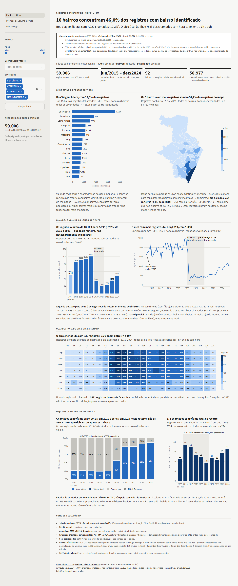

# Plataforma Serverless de Sinistros de Trânsito — Recife (CTTU)

> **Status: em construção (Fase 2 de 7).** Este README descreve o estado real
> do projeto, sem inflar o que ainda não existe. Ver `docs/ROADMAP.md` —
> é a fonte da verdade sobre em que fase estamos.

Plataforma de dados *serverless* sobre sinistros (acidentes) de trânsito do
Recife, unindo infraestrutura como código (IaC) rigorosa a um pipeline de
engenharia de dados. Projeto de portfólio pessoal.

## O que já existe (Fases 0 e 1 concluídas, Fase 2 em andamento)

- Transformação **bronze→silver** dos dados anuais da CTTU, em Python puro
  (`src/transform_sinistros.py`), com schema canônico que harmoniza a evolução
  do dado entre 2015 e 2024. Roda nos 10 anos reais (2015–2024) sem erro;
  anomalias de qualidade são sinalizadas, nunca corrigidas ou descartadas em
  silêncio (ver `docs/decisions.md`, ADR-014).
  Remove só duplicados técnicos (ver ADR-015).
- Suíte de testes local (`tests/`), sem dependência dos CSVs reais.
- Silver persistido em `data/silver/` (CSV por ano + consolidado, não
  versionado) e relatório de qualidade por ano em
  `docs/relatorio_qualidade_silver.md`.
- Dashboard interativo (`app/dashboard.py`, Streamlit), com três páginas:
  pontos críticos (ranking e mapa por bairro, série, hora × dia, severidade —
  ADR-016), previsão de volume elevado por bairro-mês e metodologia. Selo de
  cobertura em toda página. Documentação do E6 em
  `docs/entregas/E6_dashboard_consolidado.md`.
- Classificadores de volume elevado (`src/classificacao/`), porta da avaliação
  do grupo (`entrega_classificadores/`), com artefatos em `data/classificacao/`
  e teste de regressão contra os números entregues (ADR-017).
- Fase 1: conta AWS verificada, com AWS Budget de gasto zero.
- Fase 2, Estágio 0: Terraform do bucket de state em `terraform/bootstrap/`
  (ADR-011, ADR-012).

## O que ainda NÃO existe

O resto da Fase 2 (config principal do Terraform, buckets bronze/silver, VPC,
IAM, CloudWatch), a Lambda, a ingestão via API do CKAN e o CI. Ver
`docs/ROADMAP.md` para as fases.

## Arquitetura pretendida

```
Upload/ingestão de dado bruto (CTTU)
        │
        ▼
   S3 (raw/bronze) ──evento de PUT──► Lambda (validação/transformação)
        │                                      │
        ▼                                      ▼
   VPC (subnet privada) ◄─ S3 Gateway Endpoint    S3 (curated/silver)
        │
        ▼
   CloudWatch (logs, métricas, alarme de erro/custo)

Provisionado via Terraform (state em S3 + lock nativo do S3, ADR-011),
com CI via GitHub Actions + Checkov.
```

Nota de projeto: a Lambda é colocada dentro da VPC **por decisão de portfólio**,
não por necessidade funcional. Ver `docs/decisions.md` (ADR-001).

## Dashboard



Documentação da entrega: [E6 — dashboard consolidado](docs/entregas/E6_dashboard_consolidado.md) (principal) · [Entrega CC de 18/11/2026](docs/entrega-cc.md) (versão de página única).

Na raiz do repositório, com o ambiente virtual ativo:

```powershell
python -m pip install -r requirements.txt
python -m streamlit run app/dashboard.py
```

Abre em http://localhost:8501, com três páginas: **Pontos críticos** (só
chamados FINALIZADA), **Previsão de volume elevado** (classificadores, todos os
status — os dois recortes são rotulados em cada página, ADR-017) e
**Metodologia**.

**Numa cópia limpa o painel abre sem rodar nenhum pipeline:** a base de
2015–2024 e a malha vêm em `data/painel/` e os artefatos da previsão em
`data/classificacao/`, todos versionados. Se `data/painel/` não existir, a
página de pontos críticos cai para o silver local (`data/silver/`) e a malha
de `data/geo/` (ADR-018).

Para reproduzir os dados a partir das fontes:

- base do painel: `python -m src.prepara_dados_painel --baixar` (ver [data/README.md](data/README.md));
- silver completo: `python src/transform_sinistros.py`;
- malha e cadastro de bairros: `python src/baixa_malha_bairros.py`;
- artefatos da previsão: `python src/classificacao/gerar_artefatos.py`.

Prints: `docs/entregas/prints_E6/` (E6, uma por página), `docs/img/dashboard_cc.png`
(entrega CC) e `docs/img/` (E4).

## Estrutura

```
app/    dashboard Streamlit: dashboard.py (navegação), paginas/, dados e tema
src/    transformação, download de bairros e classificacao/ (classificadores)
entrega_classificadores/  entrega original do grupo (ZIP, sem os brutos)
tests/  testes locais (pytest)
docs/   ROADMAP e decisões de arquitetura (ADRs)
data/   dados locais (brutos e silver não versionados; classificacao/ versionado)
```

## Como rodar localmente

```bash
python3 -m venv .venv && source .venv/bin/activate
pip install -r requirements-dev.txt

# Rodar os testes:
pytest -v

# Rodar a transformação nos dados (após colocar CSVs em data/raw/):
python src/transform_sinistros.py
```

## Dados e licença

Fonte: **Portal de Dados Abertos do Recife** (`dados.recife.pe.gov.br`),
dataset publicado pela **CTTU**. Dados sob **Open Database License (ODbL)**.
Ver `data/README.md` para como obter os arquivos.
