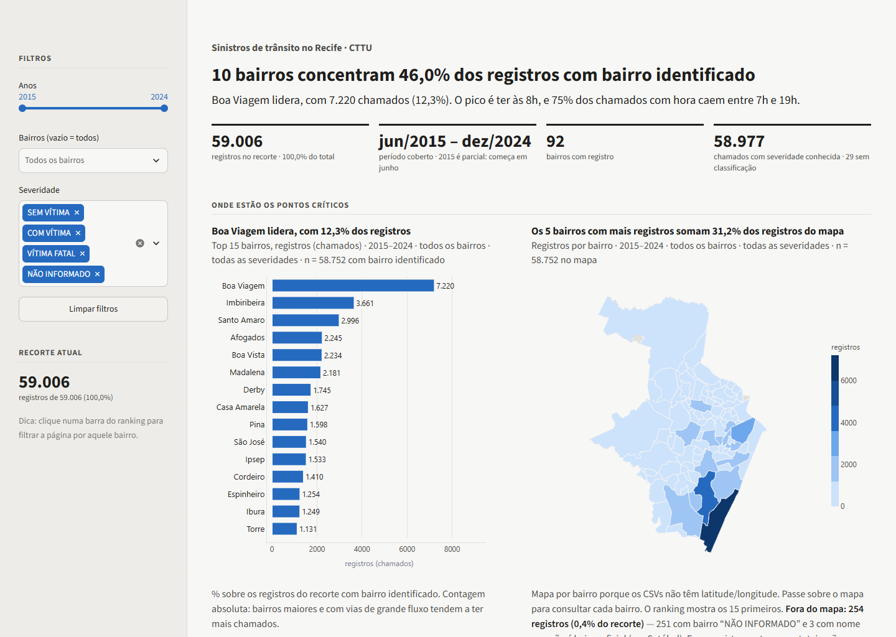

# Projeto 5 · Entrega CC

> **Nota (merge de 18/11/2026):** este documento descreve a versão de **página única** do painel, entregue em 18/11. A versão consolidada — três páginas (pontos críticos, previsão de volume elevado e metodologia), com selo de cobertura — está documentada em [`entregas/E6_dashboard_consolidado.md`](entregas/E6_dashboard_consolidado.md), que é o documento principal da entrega. Os números abaixo continuam valendo: a regra do mapa de calor desta versão foi a adotada no merge (ADR-018) e são conferidos por `tests/test_docs_e6.py`. A contagem de 49 testes é a da validação de 18/11.

**18 de novembro de 2026** · Dashboard de chamados de sinistros de trânsito no Recife

## Abrir o dashboard

[Acesse o dashboard público no Streamlit](https://recife-sinistros-cttu.streamlit.app/). O acesso é livre, sem login.

Na raiz do repositório, com o ambiente Python ativo, instale as dependências e abra o painel.

```powershell
python -m pip install -r requirements.txt
python -m streamlit run app/dashboard.py
```

Acesse [o painel local](http://localhost:8501). O recorte de 2015 a 2024 e a malha de 94 bairros acompanham a entrega em `data/painel/`. A base vem da transformação silver do projeto e inclui os campos usados nas visualizações, sem endereços nem protocolos. A extração de 18 de novembro de 2026 está registrada no [manifesto das fontes](../data/painel/fontes.json). [Dados da CTTU](https://dados.recife.pe.gov.br/dataset/acidentes-de-transito-com-e-sem-vitimas) · [Malha de bairros](https://dados.recife.pe.gov.br/dataset/area-urbana) · [Licença dos dados ODbL 1.0](https://opendatacommons.org/licenses/odbl/1-0/)



## Decisões visuais

- Os indicadores no topo descrevem o recorte. Ranking e mapa mostram onde se concentram os chamados, as séries anual e mensal e o mapa de calor mostram quando foram registrados, e os gráficos de severidade apresentam sua composição.
- Ano, bairro e severidade filtram o painel em conjunto. O ranking permite selecionar um bairro e os gráficos exibem detalhes ao passar o cursor. Os títulos e denominadores identificam o recorte analisado.
- A escala de azuis indica intensidade no mapa e no mapa de calor. Rótulos, legendas e hachuras complementam a cor. O ranking usa barras horizontais para dar espaço aos nomes dos bairros. [ADR-016 e contraste](decisions.md)

## O que os dados mostram

- Dos **59.006 chamados finalizados**, **58.752** puderam ser associados à malha. Boa Viagem concentra **7.220** deles, ou **12,3%** dos chamados mapeáveis. Os dez bairros com mais chamados somam **46,0%** desse mesmo total.
- O volume anual caiu de **10.109 em 2019** para **2.095 em 2021**, cerca de **79%**. Os chamados classificados como sem vítima passaram de **8.046** para **434**. A base mostra uma queda nos registros, com causa desconhecida.
- Dos **56.535 chamados finalizados com data e hora válidas** para o mapa de calor, aproximadamente **75%** foram registrados das 7h às 18h59, com o maior volume às **terças-feiras, das 8h às 8h59** (**833 chamados**).
- São **274 chamados** classificados como “VÍTIMA FATAL” nos dez arquivos anuais. O indicador mede chamados com pelo menos uma vítima fatal. [Relatório de qualidade do silver](relatorio_qualidade_silver.md)

O arquivo de 2015 começa em junho. Os 254 chamados sem correspondência na malha entram nos totais e ficam fora do mapa e do ranking. O volume por bairro é uma contagem absoluta. O arquivo de 2022 não tem hora preenchida. As 32 datas incompatíveis com o ano do arquivo entram nos totais e ficam fora da série mensal e do mapa de calor. Horários ausentes ou inválidos também ficam fora do mapa de calor.

## Melhorias a partir da revisão

- A etapa de 4 de novembro registrou grafias de bairro divergentes e deixou a validação móvel em aberto. A versão consolidada incorpora o de-para explícito de cinco grafias do Streamlit e adapta os indicadores e a exibição da fonte a telas estreitas. No celular, o mapa de calor exibe os valores ao tocar nas células para evitar a sobreposição de rótulos.
- A revisão visual do painel encontrou rótulos sobrepostos no mapa e baixo contraste em parte da escala contínua do mapa de calor. Os valores do mapa passaram para o ranking e para a inspeção por bairro. A escala usa seis faixas com cor de texto adequada ao fundo.
- A revisão dos filtros levou à correção do título anual que podia anunciar queda em um recorte com aumento. Os textos de severidade apresentam a proporção observada e os recortes sem bairros mapeáveis ou sem registros recebem mensagens próprias.

## Validação

O painel foi conferido no Chrome em 1440 × 1024 e em 390 × 844, sem rolagem horizontal nem erros no console. Com as requisições externas bloqueadas, as sete visualizações renderizaram, incluindo o mapa de bairros. O clique na barra de Boa Viagem aplicou o filtro com 7.220 chamados e “Limpar filtros” restaurou os 59.006 chamados da base. Em tela móvel, o toque na célula de terça-feira às 8h mostrou os 833 chamados do recorte completo.

A suíte passou com 49 testes em uma cópia limpa, incluindo filtros combinados, recorte vazio, ausência de horários em 2022 e conferência dos totais da base distribuída.
